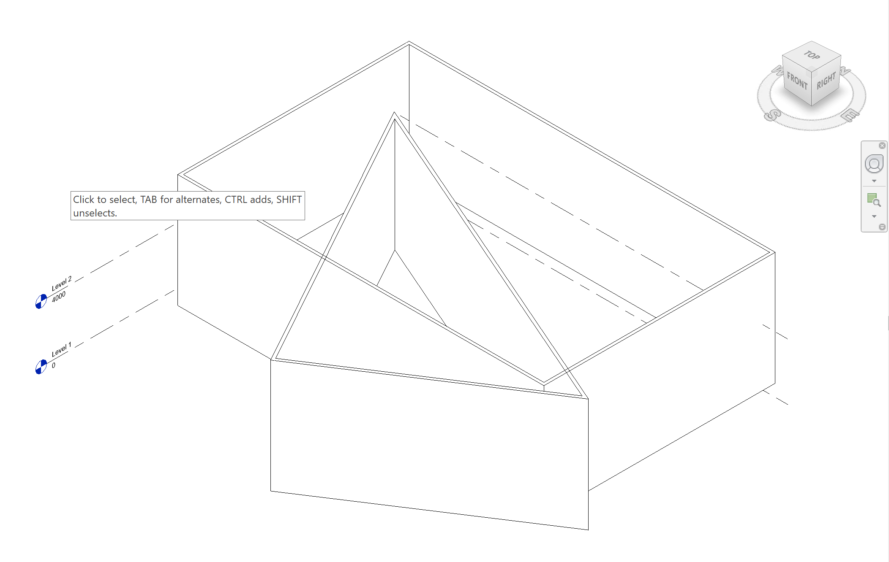

# dosymep.Revit.DotBim

[](https://www.jetbrains.com/rider)
[](LICENSE.md)
[](https://www.autodesk.com/products/revit/overview)

A Revit API library for exporting models to the [dotbim](https://github.com/paireks/dotbim) (`.bim`) format.

## Features

- Export a Revit document to a `.bim` file via an extension method on `Document`
- Optional export of linked models
- Optional element and project parameter info
- Support for Revit 2016–2027 (including `2026.5`)

## Installation

```bash
dotnet add package dosymep.Revit.DotBim
```

## Usage

```csharp
View view = uiApplication.ActiveUIDocument.ActiveView;
Document document = uiApplication.ActiveUIDocument.Document;

document.Export("path/to/sample.bim",
    new DotBimOptions {
        View = view,
        WithLinks = true,
        WithElementInfo = true,
        WithDocumentInfo = true
    });
```

| Option | Type | Default | Description |
|--------|------|---------|-------------|
| `View` | `View` | required | View used for export (must be a `View3D`) |
| `WithLinks` | `bool` | `false` | Include linked models |
| `WithElementInfo` | `bool` | `false` | Include element parameters |
| `WithDocumentInfo` | `bool` | `false` | Include project information |

## Build

The repository includes a [ModularPipelines](https://github.com/thomhurst/ModularPipelines) app in `build/`. It cleans `bin`/`obj`, restores the solution, builds `dosymep.Revit.DotBim` for each selected Revit version into `bin/<version>/`, and packages zip archives under `artifacts/`.

Pipeline stages:

1. **Clean** — remove root `bin/` and `artifacts/`, plus project `bin`/`obj` under `src/`
2. **Restore** — restore NuGet packages for the solution
3. **Build** — compile the library per Revit version
4. **Package** — zip each version output into `artifacts/`

### Prerequisites

- [.NET SDK](https://dotnet.microsoft.com/download) matching `global.json` (net10)
- Matching Revit API reference packs via `Autodesk.Revit.Sdk.Refs`

### Supported Revit versions

Built by default (local pipeline and GitHub Actions): **2016–2027**, including **2026.5**.

### Run the build pipeline

From the repository root:

```bash
dotnet run --project build
```

### Environment variables

| Variable | Default | Description |
| :--- | :--- | :--- |
| `CONFIGURATION` | `Release` | MSBuild configuration |
| `REVIT_VERSIONS` | `2016,…,2027` (incl. `2026.5`) | One or more Revit versions. Separate with commas, semicolons, or spaces |
| `MAX_PARALLELISM` | `max(1, ProcessorCount / 4)` | Max parallel work items for packaging |

#### PowerShell

```powershell
$env:CONFIGURATION = "Release"
$env:REVIT_VERSIONS = "2024,2025"
$env:MAX_PARALLELISM = "2"
dotnet run --project build
```

#### Bash

```bash
CONFIGURATION=Release REVIT_VERSIONS=2024,2025 MAX_PARALLELISM=2 dotnet run --project build
```

### Quick single-version build

Without the pipeline:

```bash
dotnet build revit-dotbim.slnx -c D2024
```

Available configurations: `D2016` … `D2027` (and `D2026.5`).

### Build outputs

```text
bin/
  2024/
    dosymep.Revit.DotBim/
  2025/
    dosymep.Revit.DotBim/
artifacts/
  dosymep.Revit.DotBim.2024.zip
  dosymep.Revit.DotBim.2025.zip
```

### Versioning

Base version lives in `Directory.Build.props` (`2.0.0`).

| Context | Example assembly version |
| :--- | :--- |
| Local / CI branch build | `2.0.0-{commit}.{revitVersion}` |
| GitHub tag `v2.1.0` | `2.1.0.{revitVersion}` |

On `v*` tags, GitHub Actions also creates a release and uploads `artifacts/*`.

## Sample




## Contributing

See [CONTRIBUTING.md](CONTRIBUTING.md).

## Credits

See [CREDITS.md](CREDITS.md).

## License

This project is licensed under the [MIT License](LICENSE.md).
