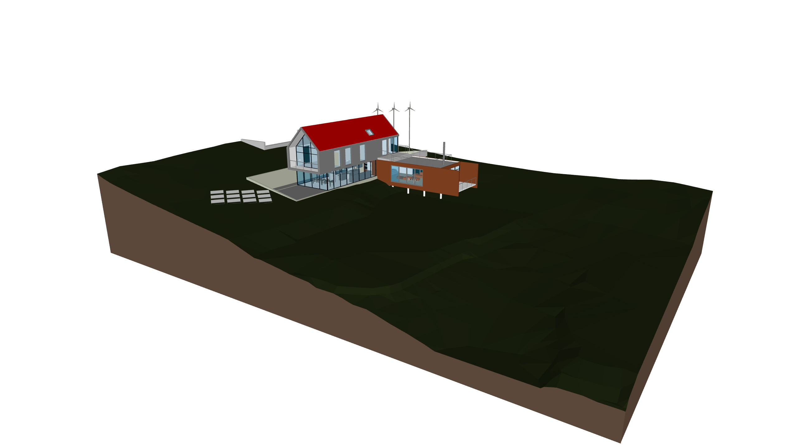

# DotBimExport

[](https://www.jetbrains.com/rider)
[](LICENSE.md)
[](https://www.autodesk.com/products/revit/overview)

[Русский](README.ru.md)

A Revit plugin for exporting 3D views to the [dotbim](https://github.com/paireks/dotbim) (`.bim`) format.
Export is implemented by the `dosymep.Revit.DotBim` library in this repository.

## Features

- Ribbon command with an export settings dialog
- 3D view selection
- Optional export of linked models, element parameters, and project information
- Model category filter
- Name language selection (`LanguageType` from Revit)
- UI localization: English (default) and Russian, based on the Revit language
- Support for Revit 2016–2027 (including `2026.5`)

## Install

1. Download `DotBimExport.{version}.zip` from [Releases](https://github.com/dosymep/revit-dotbim/releases) (match your
   Revit year).
2. Extract the archive into the Revit Addins folder for that version, for example:

   `%AppData%\Autodesk\Revit\Addins\2025\`

3. Restart Revit. The **dotbim** panel appears with **Export DotBim**.

Archive layout:

```text
DotBimExport.2025.zip
  DotBimExport.addin
  DotBimExport/
    DotBimExport.dll
    dosymep.Revit.DotBim.dll
    ru/
      DotBimExport.resources.dll
    …
```

## Usage

1. Open a document that has at least one **3D view** (not a template).
2. On the **dotbim** panel, click **Export DotBim**.
3. In the settings dialog, choose:
    - the 3D view;
    - the name language;
    - whether to export element info, document info, and links;
    - which categories to export.
4. Confirm export and choose the output `.bim` path.

The dialog and ribbon language follow the Revit language: Russian uses `ru`, everything else uses English.

### Library API

`dosymep.Revit.DotBim` exposes an extension method on `Document` if you want to call export from your own code:

```csharp
View view = uiApplication.ActiveUIDocument.ActiveView;
Document document = uiApplication.ActiveUIDocument.Document;

document.Export("path/to/sample.bim",
    new DotBimOptions {
        View = view,
        WithLinks = true,
        WithElementInfo = true,
        WithDocumentInfo = true,
        CategoryIds = null,
        NameLanguage = LanguageType.English_USA
    });
```

| Option             | Type                              | Default       | Description                                         |
|--------------------|-----------------------------------|---------------|-----------------------------------------------------|
| `View`             | `View`                            | required      | View used for export (must be a `View3D`)           |
| `WithLinks`        | `bool`                            | `false`       | Include linked models                               |
| `WithElementInfo`  | `bool`                            | `false`       | Include element parameters                          |
| `WithDocumentInfo` | `bool`                            | `false`       | Include project information                         |
| `CategoryIds`      | `IReadOnlyCollection<ElementId>?` | `null`        | Categories to export; `null` exports every category |
| `NameLanguage`     | `LanguageType`                    | `English_USA` | Language used for exported names                    |

## Build

The repository includes a [ModularPipelines](https://github.com/thomhurst/ModularPipelines) app in `build/`. It cleans
`bin`/`obj`, restores the solution, builds `DotBimExport` for each selected Revit version into
`bin/<version>/DotBimExport/`, and packages add-in zip archives under `artifacts/`.

Pipeline stages:

1. **Clean** — remove root `bin/` and `artifacts/`, plus project `bin`/`obj` under `src/`
2. **Restore** — restore NuGet packages for the solution
3. **Build** — compile the plugin (and its library dependency) per Revit version
4. **Package** — zip each version as a Revit add-in layout into `artifacts/`

### Prerequisites

- [.NET SDK](https://dotnet.microsoft.com/download) matching `global.json` (net10)
- Matching Revit API reference packs via `Autodesk.Revit.Sdk.Refs`

### Supported Revit versions

Built by default (local pipeline and GitHub Actions): **2016–2027**, including **2026.5**.

### Run the build pipeline

From the repository root:

```bash
dotnet run --project build
```

### Environment variables

| Variable          | Default                        | Description                                                             |
|:------------------|:-------------------------------|:------------------------------------------------------------------------|
| `CONFIGURATION`   | `Release`                      | MSBuild configuration                                                   |
| `REVIT_VERSIONS`  | `2016,…,2027` (incl. `2026.5`) | One or more Revit versions. Separate with commas, semicolons, or spaces |
| `MAX_PARALLELISM` | `max(1, ProcessorCount / 4)`   | Max parallel work items for packaging                                   |

#### PowerShell

```powershell
$env:CONFIGURATION = "Release"
$env:REVIT_VERSIONS = "2024,2025"
$env:MAX_PARALLELISM = "2"
dotnet run --project build
```

#### Bash

```bash
CONFIGURATION=Release REVIT_VERSIONS=2024,2025 MAX_PARALLELISM=2 dotnet run --project build
```

### Quick single-version build

Without the pipeline:

```bash
dotnet build revit-dotbim.slnx -c D2024
```

Available configurations: `D2016` … `D2027` (and `D2026.5`).

### Build outputs

```text
bin/
  2024/
    DotBimExport/
  2025/
    DotBimExport/
artifacts/
  DotBimExport.2024.zip
  DotBimExport.2025.zip
```

### Versioning

Base version lives in `Directory.Build.props` (`2.0.0`).

| Context                 | Example assembly version        |
|:------------------------|:--------------------------------|
| Local / CI branch build | `2.0.0-{commit}.{revitVersion}` |
| GitHub tag `v2.1.0`     | `2.1.0.{revitVersion}`          |

On `v*` tags, GitHub Actions also creates a release and uploads `artifacts/*`.

## Samples

The [`samples/`](samples/) folder contains Autodesk Revit sample models grouped by Revit year, plus exported `.bim` files where available.



Layout:

```text
samples/
  sample.png
  2018/
    rac_basic_sample_project.rvt
  2019/
    rac_advanced_sample_project.rvt
  2020/
    rac_advanced_sample_project.rvt
    rac_advanced_sample_project.bim
  2021/ … 2027/
    rac_basic_sample_project.rvt
    rac_basic_sample_project.bim   # present for some years
```

| Path | Contents |
| :--- | :--- |
| `samples/{year}/` | Revit sample project for that year (`2018`–`2027`) |
| `samples/{year}/*.rvt` | Source model (`rac_basic_sample_project` or `rac_advanced_sample_project`) |
| `samples/{year}/*.bim` | Exported dotbim file (when present) |
| `samples/sample.png` | Preview of an exported model |

Open the matching `.rvt` in Revit, run **Export DotBim**, and compare the result with the `.bim` next to it when one is checked in.

## Contributing

See [CONTRIBUTING.md](CONTRIBUTING.md).

## Credits

See [CREDITS.md](CREDITS.md).

## License

This project is licensed under the [MIT License](LICENSE.md).
